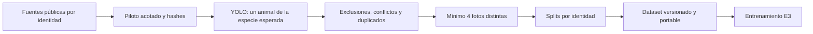

# Pipeline de datos previo al entrenamiento E3

La preparación pública es una etapa independiente. Produce una versión portable de imágenes, etiquetas y splits; el entrenamiento verifica esa versión y la reutiliza. No entrena ni publica modelos y no descarga fotos privadas de PetTrace.



## Notebook de datos compartido

El pipeline de preparación se presenta en [datasets/prepare_training.ipynb](../datasets/prepare_training.ipynb), separado de los notebooks experimentales. Produce `pettrace-training`, una base de entrenamiento con versiones locales como `v1` y publicación privada opcional en HF. El benchmark `pettrace-reid@v4` permanece independiente. Véase [datasets/README.md](../datasets/README.md) para la organización y el consumo de versiones.

El piloto mantiene hasta 300 perros y 300 gatos, diez fotos por individuo y semilla 42; reutiliza las fuentes ya descargadas bajo `public/e3-body`. Los snapshots compartidos se guardan en `datasets/build/pettrace-training` y pueden reutilizarse en otros experimentos. `PUBLISH_TO_HF = False` deja todos los datos locales hasta activar explícitamente la publicación.

## Alternativa por comando

Con la imagen del proyecto ya construida (`make image`), el comando usa el runner Docker existente y los accesos de `.env`:

```sh
make prepare-e3
```

`PREPARE_ARGS` permite pasar opciones adicionales, por ejemplo `make prepare-e3 PREPARE_ARGS="--detector-dir artifacts/e2"`.

La preparación requiere únicamente el detector ONNX de E2 y su especificación. `--detector-dir` utiliza archivos locales; en otro caso se descargan solo `detector.onnx` y `pipeline.yaml` del modelo `models:/pettrace-embedder/2`. Se verifica la huella fijada del detector. Los accesos MLflow son de lectura y se proporcionan mediante el entorno; no se solicita HF_TOKEN. El encoder y el benchmark privado se cargan durante el experimento.

## Uso en Colab

Se prepara el dataset desde un terminal y se coloca la carpeta completa de la versión en el runtime de entrenamiento, conservando `images/` y los manifiestos. Si el comando se ejecuta en ese mismo entorno, no es necesario transferir la carpeta. La preparación se ejecuta en el notebook de datos o por CLI; los notebooks experimentales consumen el resultado.

Después se abre [e3_mlp_head_triplet.ipynb](../notebooks/e3_mlp_head_triplet.ipynb) y se fija `E3_PREPARED_DATASET` a esa carpeta. El experimento encuentra la versión compartida `datasets/build/pettrace-training/v1.json`, conserva compatibilidad con `datasets/public/e3-body/prepared/latest.json` y permite cargar una versión HF por commit. El experimento verifica el dataset y registra su fingerprint antes de entrenar.

## Comando independiente

Desde la raíz de pettrace-ml, con los accesos MLflow en el entorno:

```sh
uv run pettrace-prepare-e3 --allow-download
```

Con un detector local y extracciones existentes:

```sh
uv run pettrace-prepare-e3 \
  --data-root datasets/public/e3-body \
  --detector-dir artifacts/e2 \
  --dog-root datasets/dogs-world \
  --cat-root datasets/lcw
```

Sin `--allow-download`, el comando requiere extracciones manuales o pilotos completos verificables. La adquisición automática usa rangos HTTP con presupuestos acotados; nunca descarga los archivos completos como fallback. Semilla y tamaños pueden fijarse con `--seed`, `--identities-per-species` y `--photos-per-identity`. Para cambiar la configuración de una adquisición existente se usa otra raíz; el recibo evita mezclar pilotos.

## Contrato de salida

Cada snapshot se guarda en `OUTPUT_ROOT/<fingerprint>/` y contiene los archivos siguientes. El notebook compartido usa `datasets/build/pettrace-training` como `OUTPUT_ROOT`; el CLI conserva `DATA_ROOT/prepared` como valor por defecto.

- `images/`: copias de las imágenes retenidas, independientes de las fuentes originales.
- `manifest.csv`: rutas relativas, fuente, especie, individuo, split y SHA-256.
- `excluded.csv`: una fila por foto descartada y el motivo principal.
- `animal-screening.json`: detecciones, cajas, puntuaciones, motivos y parámetros YOLO.
- `audit.json`: deduplicación, conflictos, revisión y conteos de curación.
- `review.csv` y `sources.json`: decisiones originales y procedencia de fuentes.
- `summary.json`: conteos finales por especie y split, motivos y limitaciones.
- `visual-sample.json` y `samples/`: muestra reproducible de cuatro identidades por especie.
- `prepared.json`: estado terminado, configuración, huella de inputs e inventario de hashes de todos los archivos.

`latest.json` se actualiza al completar y validar una versión. Una ejecución fallida no reemplaza la versión previa. La huella vincula fotografías, etiquetas y decisiones originales, detector, parámetros, código y versiones del runtime. Una repetición con inputs iguales reutiliza la versión después de verificarla. La caché YOLO permite reanudar el filtrado por foto. La descarga de imágenes usa cuatro conexiones por defecto, con presupuesto de red compartido y un número acotado de peticiones en vuelo. `--download-workers` (1–16) o `DOWNLOAD_WORKERS` en el notebook permite ajustar ese transporte sin cambiar IDs ni invalidar el recibo de una descarga parcial. Los archivos existentes se verifican por tamaño y CRC; solo se descargan los ausentes o corruptos. El progreso indica fotos reutilizadas, velocidad y ETA.

La carpeta completa de una versión puede copiarse a otro runtime. `load_prepared(carpeta)` resuelve las rutas relativas, valida cada archivo y comprueba que ninguna identidad cruce splits. Exige al menos cuatro fotos distintas por individuo y, para cada especie, ocho identidades de train, dos de validación y dos de test. El entrenamiento registra el fingerprint utilizado y se detiene si falta o cambió un artefacto. Las imágenes no dependen de que sigan existiendo las extracciones originales.

## Política y límites

YOLO usa confianza 0.25 y NMS entre clases con IoU 0.5. Se excluyen fotos ilegibles, sin detecciones, con varios animales o con una especie inesperada. Después se respetan descartes manuales y exclusiones conocidas, se ponen en cuarentena identidades con hashes compartidos entre etiquetas y se eliminan duplicados y casi duplicados. El mínimo de fotos y la división por individuo se calculan después de filtrar.

El modo exploratorio conserva etiquetas del publicador sin declararlas verificadas visualmente. Las decisiones pendientes no se convierten en aprobaciones. Una sola detección no verifica identidad; animales ocluidos, falsos positivos y cambios de pose pueden afectar el filtro. La muestra visual no garantiza la calidad de todas las etiquetas ni certifica sesiones independientes. El test público permanece fuera del optimizador y la selección de checkpoint.

## Actualizar una descarga iniciada con el descargador secuencial

Interrumpir solo la celda de preparación, conservar el runtime y los archivos, y ejecutar nuevamente el notebook actualizado desde la celda de instalación del paquete. El arranque detecta el descargador antiguo, actualiza el paquete y recarga los módulos; la preparación siguiente verifica y reutiliza los archivos ya guardados. No se debe borrar la raíz de datos para cambiar el número de conexiones. La lectura del índice ZIP y, para perros, del prefijo de metadatos, puede repetirse al reanudar una adquisición incompleta.
