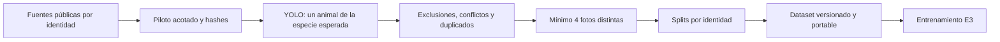

# Pipeline de datos previo al entrenamiento E3

La preparación pública es una etapa independiente. Produce una versión portable de imágenes, etiquetas y splits; el entrenamiento verifica esa versión y la reutiliza. No entrena ni publica modelos y no descarga fotos privadas de PetTrace.



## Ejecución en Colab

1. Ejecutar [e3_prepare_data.ipynb](../notebooks/e3_prepare_data.ipynb). Usa el piloto de 300 perros y 300 gatos, hasta 10 fotos por individuo y semilla 42. Reutiliza la adquisición y las decisiones existentes bajo `E3_DATA_ROOT`.
2. Revisar el resumen de exclusiones y la muestra visual por especie. No exige marcar cada fotografía.
3. Ejecutar [e3_mlp_head_triplet.ipynb](../notebooks/e3_mlp_head_triplet.ipynb). Encuentra `prepared/latest.json` en la misma raíz o utiliza `E3_PREPARED_DATASET` para fijar una versión concreta.

El primer notebook requiere únicamente el detector ONNX de E2 y su especificación. Con `E3_DETECTOR_DIR` se utilizan archivos locales; en otro caso se descargan solo `detector.onnx` y `pipeline.yaml` del modelo `models:/pettrace-embedder/2`. Se verifica la huella fijada del detector. Los accesos MLflow son de lectura, mediante entorno, Secrets o campos ocultos; no se solicita HF_TOKEN. El encoder y el benchmark privado se cargan en la etapa de entrenamiento/evaluación.

## Comando independiente

Desde la raíz de pettrace-ml, con los accesos MLflow en el entorno:

```sh
uv run pettrace-prepare-e3 --allow-download
```

Con un detector local y extracciones existentes:

```sh
uv run pettrace-prepare-e3 \
  --data-root datasets/public/e3-body \
  --detector-dir artifacts/e2 \
  --dog-root datasets/dogs-world \
  --cat-root datasets/lcw
```

Sin `--allow-download`, el comando requiere extracciones manuales o pilotos completos verificables. La adquisición automática usa rangos HTTP con presupuestos acotados; nunca descarga los archivos completos como fallback. Semilla y tamaños pueden fijarse con `--seed`, `--identities-per-species` y `--photos-per-identity`. Para cambiar la configuración de una adquisición existente se usa otra raíz; el recibo evita mezclar pilotos.

## Contrato de salida

Cada versión se guarda en `DATA_ROOT/prepared/<fingerprint>/` y contiene:

- `images/`: copias de las imágenes retenidas, independientes de las fuentes originales.
- `manifest.csv`: rutas relativas, fuente, especie, individuo, split y SHA-256.
- `excluded.csv`: una fila por foto descartada y el motivo principal.
- `animal-screening.json`: detecciones, cajas, puntuaciones, motivos y parámetros YOLO.
- `audit.json`: deduplicación, conflictos, revisión y conteos de curación.
- `review.csv` y `sources.json`: decisiones originales y procedencia de fuentes.
- `summary.json`: conteos finales por especie y split, motivos y limitaciones.
- `visual-sample.json` y `samples/`: muestra reproducible de cuatro identidades por especie.
- `prepared.json`: estado terminado, configuración, huella de inputs e inventario de hashes de todos los archivos.

`latest.json` se actualiza al completar y validar una versión. Una ejecución fallida no reemplaza la versión previa. La huella vincula fotografías, etiquetas y decisiones originales, detector, parámetros, código y versiones del runtime. Una repetición con inputs iguales reutiliza la versión después de verificarla. La caché YOLO permite reanudar el filtrado por foto.

La carpeta completa de una versión puede copiarse a otro runtime. `load_prepared(carpeta)` resuelve las rutas relativas, valida cada archivo y comprueba que ninguna identidad cruce splits. Exige al menos cuatro fotos distintas por individuo y, para cada especie, ocho identidades de train, dos de validación y dos de test. El entrenamiento registra el fingerprint utilizado y se detiene si falta o cambió un artefacto. Las imágenes no dependen de que sigan existiendo las extracciones originales.

## Política y límites

YOLO usa confianza 0.25 y NMS entre clases con IoU 0.5. Se excluyen fotos ilegibles, sin detecciones, con varios animales o con una especie inesperada. Después se respetan descartes manuales y exclusiones conocidas, se ponen en cuarentena identidades con hashes compartidos entre etiquetas y se eliminan duplicados y casi duplicados. El mínimo de fotos y la división por individuo se calculan después de filtrar.

El modo exploratorio conserva etiquetas del publicador sin declararlas verificadas visualmente. Las decisiones pendientes no se convierten en aprobaciones. Una sola detección no verifica identidad; animales ocluidos, falsos positivos y cambios de pose pueden afectar el filtro. La muestra visual no garantiza la calidad de todas las etiquetas ni certifica sesiones independientes. El test público permanece fuera del optimizador y la selección de checkpoint.
